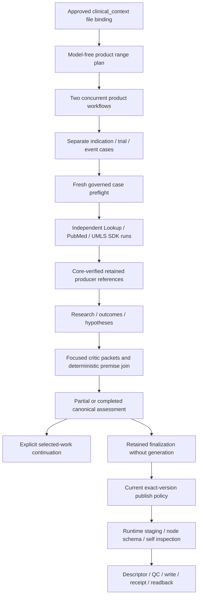

# Clinical Failure Intelligence 0.1.10

This version adds deterministic product selection, focused scientific review,
explicit retained-work continuation, and provider-free publication preparation.
It preserves every previously published implementation and manifest version.
The original 0.1.9 execution and its retained artifact remain unchanged.

## Execution model



The adapter owns semantic selection and validation. The official SDK host owns
durable submission checkpoints. Assets and Core own admission, credentials,
bindings, schema authority and durable writes. No lake backend logic is embedded
in the scientific workflow. The same manifest permits local_worker and ECS;
this development work does not deploy or qualify ECS.

## Product indexes

`variables.product_index_range` is optional. It uses zero-based inclusive
indexes of distinct product IDs in first-appearance order in the complete
governed input snapshot:

| Value | Products selected |
|---|---|
| `0:1` | First and second |
| `2:3` | Third and fourth |
| `3:3` | Fourth only |

Repeated event rows for a product do not create new indexes. A source checksum
and ordered-product digest pin the selection. Every case verifies them again
after fresh input hydration and before source or Agent calls. A changed snapshot
requires a new reviewed plan; indexes are never silently shifted.

The range planner takes range-level variables only; omit subject_id, product_id,
event_ids, indication_id, trial_id and source_object_id. It returns exact case
selectors. Multiple indications or trial associations are not multiplied into
invented pairs. Ambiguous/future rows remain explicit blocked cases. Unreported
trial identity remains unresolved and cannot trigger an exact-trial source call.
Cases within one product execute sequentially; at most two products execute
concurrently. Each case receives its own SDK checkpoint and producer run refs.

Without a range, the existing single-case execution path remains available.
A range alone with preflight_only=true returns product_selection and makes zero
Agent calls. Paid execution uses the operator coordinator below; a worker does
not invoke nested source adapters.

From this adapter directory, the following command only prints a local plan:

```powershell
& $py -B .\tests\operator\run_product_range.py `
  --config $configFile --variables-file $rangeVariablesFile `
  --product-index-range '0:1' --checkpoint-directory $rangeCheckpointDirectory
```

After promotion, registration, current input bindings and role admission:

- Add `--live --env-file $envFile` for governed model-free selection/case checks.
- Add `--analyze` only when source reads and Agent calls are authorized.
- Use `--resume` with the same checkpoint directory after observation timeout.
- Unknown submission acknowledgements require reconciliation of the saved
  operation; the host does not submit a replacement workflow.
- Do not reuse single-case variables files containing hidden selectors.

The coordinator prints safe IDs/status/counts. Detailed producer results remain
in its private retained directory; no provider payloads enter the command output.

## Scientific review repair

Each critic packet retains the assigned candidate's complete source windows and
case anchors. It carries full derived premise records and exact source IDs,
without repeating every premise's raw source text in each dependent hypothesis.
Prompts explicitly prohibit claiming those unseen sources were read. Premises
receive their own reviews; the deterministic final join revokes acceptance of a
dependent candidate when any premise is unaccepted.

Missing dependency IDs are retained as unresolved_dependency_ids. Such a
candidate can receive a completed, inconclusive review but cannot be accepted.
The dynamic hypothesis schema permits only canonical supplied outcome IDs as
dependencies, preventing invented researcher-claim or batch-prefix references.
A completed critic review with insufficient definitive evidence is an explicit
inconclusive scientific disposition, with its evidence issue retained.

Prompt contract 1.7.0 includes exact dependency rules and section-aware memory
operations. A missing memory section permits add_section; an existing section
uses append or an exact selected paragraph/digest operation. Memory is still
read-only: preview can prepare reviewed edits but never commits them.

## Selected-work continuation

Use a fresh admitted 0.1.10 execution with exactly one retained input selector:

```json
{"previous_assessment":{"run_uuid":"<retained-0.1.9-run-uuid>"}}
```

For a later 0.1.10 result use previous_continuation instead. These manifest
roles declare exact producer versions and clinical_intelligence as the output
role. Callers provide a run UUID, never inline result records or provenance.
Assets/Core verify client, terminal state, producer, retention expiry and bytes.

Supply the same governed clinical_context case, source snapshot, as_of_date and
scientific mode as the source result. Add resume_work_ids containing explicit
deferred_work.tasks work IDs, plus max_continuation_calls (integer 1..8).
`memory_preview` may be selected if the saved memory preview was deferred and
memory_mode is preview. preflight_only=true produces a model-free continuation
plan. A new paid invocation requires separate current execution authorization;
saved retry_authorized=false fields never authorize it.

Supported technical continuation: candidate reviews, deferred critic packets,
and memory preview. Missing primary evidence, research gaps and identity changes
are returned as requires_fresh_evidence_or_scientific_scope; they do not trigger
automatic regeneration. Unselected candidates and the exact source ledger are
preserved, subject only to deterministic revocation of unsupported acceptance.
Every continuation includes source artifact checksum, result/ledger digests,
resolved work IDs, remaining work and new call counts. Historical stages remain
separate from new stages. Total Agent calls, including repair, cannot exceed the
selected invocation's budget. Combining a range plan and continuation is rejected.

## Finalize an existing retained result for publication

This mode copies the retained scientific assessment into a new versioned
artifact, preserves its partial/completed status, candidates, deferred work and
source evidence, and adds lineage under execution.retained_finalization. It
does not repair scientific findings or claim they were freshly reviewed.

Use the retained selector above and the normal matching semantic case variables:

```json
{
  "finalize_only": true,
  "preflight_only": false,
  "prepare_result_for_persistence": true,
  "memory_mode": "off",
  "enable_refinement": false,
  "supplementary_search": false,
  "enable_pharmacological_class": false
}
```

Omit resume_work_ids. The adapter returns clinical_intelligence_records with one
complete assessment and makes zero Agent or Skill calls. For a model-free plan,
set preflight_only=true and prepare_result_for_persistence=false.

Launch finalization through the existing governance
`POST /governance/publish-policies/{policyId}/prepare-output` flow, with an
approved policy owned by the caller for the exact 0.1.10 asset and intended
lake/node. Select clinical_intelligence_records as the output role and use the
current governed input binding. The existing flow adds runtime-owned output
authority and staging; plain execute_asset alone does not imply publication.
Never widen or reuse the old 0.1.9 policy as authority for 0.1.10.

The target node must accept the 0.1.10 DTO. Verify its full canonical schema and
hash, materializer/JSONL compatibility, runtime self-inspection, Core descriptor,
QC, upload/write completion and exact artifact checksum/readback. Stop on a
schema or authorization mismatch; do not bypass those gates. Only a confirmed
Core publication receipt establishes publication. Adapter output deliberately
keeps publication_confirmed=false and persistence.status=not_attested.

## Qualification checklist

- [x] Inclusive distinct-product selection and pinned source/index order.
- [x] Exact indication/trial/event isolation and two-product concurrency.
- [x] Trusted runtime Agent/Skill accessors survive case scoping.
- [x] Independent source runs hand off retained UUID references per case.
- [x] Assigned evidence preserved; transitive raw-source duplication removed.
- [x] Missing premises cannot be accepted or erase independent reviews.
- [x] Dynamic dependency and memory operation schemas match supplied context.
- [x] Explicit bounded continuation preserves completed work and lineage.
- [x] Provider-free retained finalization preserves scientific uncertainty.
- [x] Existing publication controls remain mandatory; no receipt invented.
- [x] Previously published source bytes and manifest versions frozen by tests.
- [ ] New version promoted, registered and admitted with prompt contract 1.7.0.
- [ ] Exact-version input binding and publish policy activated/verified.
- [ ] Canonical target node schema accepts the promoted 0.1.10 DTO.
- [ ] Signed model-free range/continuation/finalization qualification.
- [ ] Authorized new scientific run, if needed; independent domain review.
- [ ] Real Core publication receipt plus checksum/readback qualification.
- [ ] Machine native-crash root cause resolved; current affinity is a workaround.

Test counts and the retained-packet sizing comparison are recorded in the
development report. Provider-free tests do not certify scientific accuracy or
cloud deployment. This implementation submits no paid run or publication.
