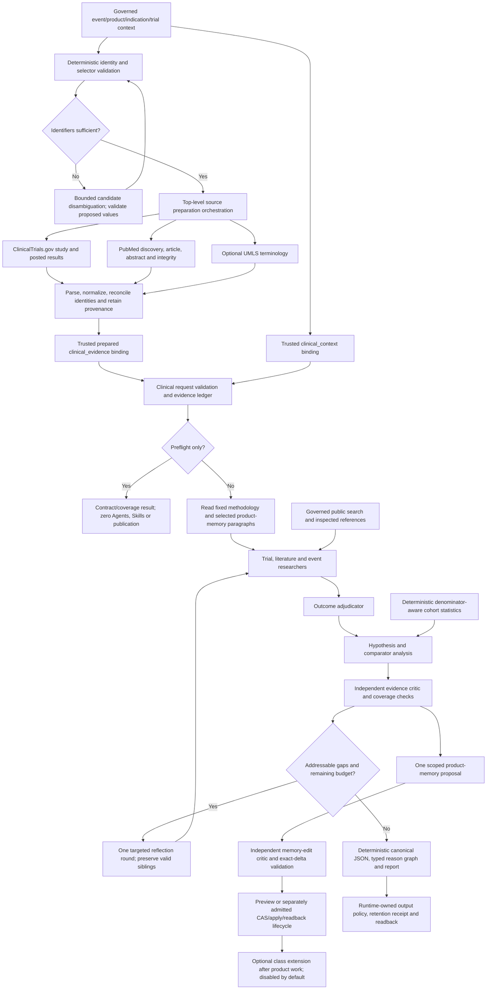
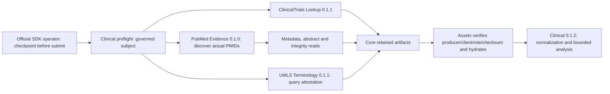

# Clinical Failure Intelligence — requirements, execution model and promotion gates

Review date: 19 October 2026 (Asia/Amman). Main scope: `nusaibah.clinical_failure_intelligence`. Source adapters are dependencies, not replacement clinical analysts. This document incorporates the user's instructions to implement source invocation, complete parsing/normalization, bounded reflection/reflexion, governed public-domain search, role-specific thinking, and a full checklist before promotion.

## Evidence and authority

- [PI-2061](https://linear.app/pipharma/issue/PI-2061): product-first clinical analysis, evidence/reason graph, case and cohort modes, read/preview/apply separation, independently proven runtime capabilities.
- [PI-2068](https://linear.app/pipharma/issue/PI-2068): independent source adapters and lawful clinical composition; nested callable execution is not assumed.
- [PI-2066](https://linear.app/pipharma/issue/PI-2066): exact signed clinical local-worker no-write qualification, distinct from generic callable probes.
- [PI-2062](https://linear.app/pipharma/issue/PI-2062), [PI-2063](https://linear.app/pipharma/issue/PI-2063): independent child Agent admission and child-governed input preparation.
- [PI-2065](https://linear.app/pipharma/issue/PI-2065): ECS live parity is separate from declarations/builds.
- [PI-2071](https://linear.app/pipharma/issue/PI-2071), [PI-2075](https://linear.app/pipharma/issue/PI-2075): PubMed source semantics and UMLS unknown provenance/semantic-certification boundaries.
- Intake PR #155 at `4d680756abc4fc0e47806aa0fdbd3879c30d0182`, stacked on #143 at `df152e066ded54992d82d1492c3ea03846b93582`.
- Assets rehearsal baseline `e59ec6d4ad297c29cfcf94f002543689c7adb497`, runtime 0.1.123. Clinical 0.1.2 is a separate development candidate on the PR #155 source. Seven Agent contracts/prompts are 1.2.0; Fixed methodology remains 1.1.0. UMLS is pinned to 0.1.1 from dependency PR #156. No installed runtime, source configuration, published catalogs or live workers are changed by this candidate.

Linear's Done labels do not certify all acceptance gates. Read issue descriptions, latest comments and exact execution evidence separately.

## Full execution model

The implemented composition path is a top-level official SDK workflow, not a clinical child invoking source grandchildren. It first gets the governed subject through clinical preflight, independently submits exact registered source runs, retains normalized outputs through the official SDK, and passes only producer run UUIDs into clinical input roles. Existing Assets/Core retained-output admission checks same client, exact producer version/output role, expiry and artifact checksum before hydration. No new Core or SDK API is introduced. Provider-free host tests prove protocol/error behavior, not live admission. The current source-assisted operator handles one explicitly selected NCT; cohort analysis consumes separately governed denominator-aware inputs. Clinical remains callable on prepared bindings.

The clinical business adapter never calls OBS, Core, provider HTTP, storage or source implementation classes. The operator is a developer tool excluded from the promoted business package. Missing/ambiguous NCT identity returns a scoped error before source calls; there is no model that manufactures an association. Typed confirmed source failures preserve successful siblings; an unknown submission acknowledgement halts for reconciliation and the same checkpoint must be retained.

## Required data and source invocation contracts

| Step | Required behavior |
|---|---|
| Request selection | Validate canonical product/event/indication/trial scope against governed context. Exact NCT/PMID/CUI syntax. Keep missing, ambiguous and mismatched identities distinct. Never invent an event association. |
| Input preparation | Derive selectors deterministically from trusted context and actual prior source results. An optional disambiguation Agent returns typed candidate values plus source references. Deterministic validation controls all calls; Agent output grants no capabilities. |
| ClinicalTrials.gov | Exact `study_get` and `results_get` for the governed selected NCT. A missing NCT requires explicit resolution before this source-assisted operator submits calls; it does not automatically launch `study_search`. Preserve protocol versus posted results, arms versus analysis groups, safety, endpoint hierarchy and missing/no-result statuses. |
| PubMed | `trial_publications` or typed bounded search, followed by exact PMID metadata/abstract and integrity reads where required. Search IDs are leads; publication type, dates and actual passages determine clinical evidence eligibility. |
| UMLS | Bounded `search` for terminology candidates/aliases when useful. Use producer 0.1.1; preserve its closed runtime fetch receipt and exact selector commitment. Full-fetch record digest/count are validated by the producer/worker before limiting. Clinical validates shape/selector and retains receipt identity without re-authenticating a receipt or recomputing a full-fetch digest from projected records. Release/provider retrieval time/completeness remain nullable. No inferred gene function, drug equivalence, efficacy or causal support. |
| Parsing | Validate exact source version/output role/schema, operation, terminal state, record count, requested-versus-returned identity, malformed envelopes, partial pages and explicit limits. No permissive parsing of truncated model JSON. |
| Normalization | Registry windows retain JSON pointers; publication passages retain actual accessible extent and date precision; terminology stays outside outcome evidence. Preserve complete windows, duplicates' equivalent-source receipts, contradiction and omissions. |
| Handoff | `clinical_evidence_bundle.v1`, exact subject/product/events, pinned source identities, result digests and real execution references. Digests prove integrity, not runtime admission. Trusted binding preparation remains mandatory. |
| Empty/error behavior | No-match, absent posted results, ambiguity, missing IDs, unavailable source, expired authority and malformed programming data remain different states. Retain successful independent sources. Do not turn absence into a negative clinical conclusion. |

Full source-result bodies must not be forwarded through restricted callable variables. Parent semantic selectors remain bounded; prepared evidence enters a binding-owned object/file lane. No generic HTTP fallback and no new storage plane.

## Agent roles, prompts and thinking

All roles use a common scope/evidence policy and their own reviewed prompt and typed response contract. Provider/model and actual thinking settings belong to approved runtime Agent definitions; an adapter prompt is not admission. Do not guess unsupported provider parameter names or request private chain-of-thought. Return concise evidence-linked rationale, uncertainty and checks.

| Role | Responsibility | Reasoning policy | Grounded search |
|---|---|---|---|
| `trial_researcher` | Registry/protocol/results evidence and exact trial identity | Standard for extraction; deeper for contradictions/design interpretation | Only to fill a named registry/history/regulator gap |
| `literature_researcher` | PMID-linked studies, study relevance, accessible passages and integrity | Standard extraction; deeper for conflicting results | Targeted missing-primary-study or contradiction search |
| `event_researcher` | Dated sponsor/regulator programme decisions; reported cause versus inference | Standard, with deeper disambiguation when needed | Primary sponsor/regulator domains first; news is a discovery lead |
| `outcome_adjudicator` | Separate trial disposition, primary endpoint, safety, programme and regulatory outcome | High; never equate termination or incoming fail flag with causal failure | No autonomous broad search; return named evidence gaps |
| `hypothesis_analyst` | Mechanism, exposure/design alternatives, matched comparators and falsification | High; explicit uncertainty, no unsupported probability | Request targeted evidence through the governed research path |
| `evidence_critic` | Independent claim/evidence, counterevidence, scope, temporal and coverage review | High; independent verdict for each item | Requests specific follow-up; cannot invent a source |
| `product_memory_editor` | Keep/enrich/correct/append exact scoped paragraphs from accepted findings | Standard; high for a correction with conflicting historical evidence | No independent search; use admitted accepted evidence only |

The coordinator, schema compiler, taxonomy checks, graph construction, statistics and selector validation are deterministic. No additional paid planner is required by default.

Grounded public-domain search supplements structured sources. Provider-native citations are discovery references until trusted `open_reference(..., mode=http)` inspects actual text. Public availability does not establish completeness, access rights or clinical validity. Record domain, publication/update date when observed, retrieval date, extent, exact passage digest and support/counterevidence. Exclude inaccessible/paywalled text rather than fabricating a full-text reading.

## Bounded reflection and reflexion

These bounds are implemented and covered by provider-free regressions. They are local ceilings, not provider admission or live runtime proof:

| Mechanism | Limit and stop rule |
|---|---|
| Research self-check | One in-response completeness check per task, using assigned obligations and unresolved reasons. No extra paid self-review call by default. |
| Independent reflection | At most one critic-directed refinement round for the assessment. At most two distinct targeted research tasks and four additional Agent invocations total; the current coordinator selects the first critic-prioritized target and re-runs analysis/review only when admissible evidence or corrected claims change. Large re-review may still defer at the shared ceiling, preserving and withholding affected candidates explicitly. |
| Novelty | Deduplicate by role, question, evidence revision and scope. Identical work reuses the in-run result. Stop when no new admissible evidence or corrected reasoning appears. |
| Preservation | Keep valid sibling findings and provenance. Re-review any dependent conclusion whose premise changed; never silently retain its previous accepted status. |
| Reflexion/learning | At most one product-memory change proposal and one independent edit-review pass per assessment. No repeated self-rewriting, recursive annex/history or learning from unaccepted hypotheses. |
| Product memory | At most 8 complete paragraphs, 3,000 characters each and 12,000 selected characters. Scope is product → indication → trial/event → regimen. |
| Class extension | Explicit opt-in after product analysis. No calls by default. Must have its own declared/admitted read role; class mutation is a separate capability and proof. |
| Overall bounds | Two concurrent research tasks; a 32-call shared Agent ceiling, 1,800-second execution budget and 120-second completion reserve. Work exceeding any budget returns explicit partial/deferred coverage. Provider retry/cooldown remains runtime-owned. |

The original 12-call/unpartitioned implementation deferred 17 research chunks and never dispatched outcome/hypothesis stages on the retained registry case. The 0.1.2 implementation sizes complete signed-business packets, partitions research/outcome/hypothesis/critic work and reserves downstream calls. The retained 264-window case now dispatches all stages in 21 logical calls with no oversized packets under typed unresolved doubles. This is structural execution proof, not scientific model evaluation. Synthetic regressions also exercise populated research claims and exact per-stage evidence scope.

Reflection handles reasoning/coverage gaps. Reflexion proposes learning from reviewed results. Neither authorizes a write, proves scientific truth, or bypasses missing evidence or a rejected capability.

## Clinical outputs and lifecycle

- Preserve `mechanistic_case` and `cohort_pattern`. Failure-only events cannot support cohort success-rate inference; require approved denominator-aware success/failure/unknown records, temporal scope and independent comparison groups.
- Keep the incoming fail selection, trial disposition, endpoint, safety, programme/regulatory decision, reported causes, supported contributors and hypotheses separate.
- Preserve original source hypotheses/observations/indicators separately from new research. The 13 source seeds are not scientific gold labels.
- Emit canonical `clinical_intelligence.v1`, typed reason graph, evidence/source/coverage receipts, contradictions, unresolved work, model/Skill/prompt revision and independent memory/persistence statuses.
- Use 4 MiB source-bundle/canonical-output warning thresholds without throwing adapter size errors; the callable contract separately declares 4 MiB, while runtime transport and retention limits remain authoritative. Preserve complete upstream results with size warnings. Canonical indexing is bounded with explicit omissions; results/safety are prioritized before contact/location metadata both during normalization and in prompts. Prioritize complete scientific evidence over contact/location metadata in prompts. Partition full evidence between requests; preserve canonical source once. Presentation compaction cannot silently remove scientific data.
- Current result-record preparation is optional and `dry_run`. Actual JSONL output requires approved target policy, exact per-record schema, Core validation/QC, terminal receipt and readback. Linear records a JSONL schema-enforcement gap; do not relabel JSONL as JSON to bypass it.
- Product Skill writes require a separately admitted runtime capability and preview/CAS(expected_digest)/receipt/fresh-readback/history. Unknown write acknowledgments must be reconciled, never blindly retried. Default mode remains preview/off until that gate is proven.
- Durable stage recovery and cross-run cache are not claimed by an in-memory cache or resume descriptor.

## Implementation checklist

Checked items are source/provider-free evidence, not paid/live approval. Package and hosted-CI evidence is captured against the exact candidate commit separately.

- [x] Linear scope, complete clinical model, source ownership and staged evidence requirements.
- [x] Clinical 0.1.2; Agent contract/prompt 1.2.0; unchanged Fixed methodology 1.1.0.
- [x] Exact dependency pins: Lookup 0.1.1, PubMed 0.1.0, UMLS 0.1.1.
- [x] Deterministic governed identity/selector preparation; actual discovered PMIDs; missing identity fails before source submission.
- [x] Independent source invocation via official SDK operator and existing retained-output references; no nested or direct provider calls.
- [x] Exact source/result/operation/record identity, count, digest, subject, date and partial-result validation.
- [x] Registry/PubMed normalization and terminology attestation consumption without semantic overclaim.
- [x] Complete evidence packets, claim/premise closure, scientific priority, exact per-stage scope and bounded downstream budgets.
- [x] One reflection round, novelty stop, four extra calls, dependent invalidation; one product proposal/review, no learning writes.
- [x] Standard/high role policies and bounded governed public search with independently inspected references.
- [x] Provider-free default plan, unknown-ack stop, same-UUID resume, checkpoint locks, code/server binding and retained-file integrity checks.
- [x] 4 MiB warning behavior preserves canonical content; model packet allowances remain separate and explicit.
- [x] Fix original official-intake packaging rejection and wheel prompt import closure; retain exact prompt digests.
- [x] Regressions for case/cohort denominators, partial-source failures, scope forgery, malformed attestation, complete-window priority and scientific/reference closure.

## Promotion and release gates

These are not marked done by passing source tests:

- [ ] Exact-head source CI on Linux/Windows Python 3.10/3.13 and repository shape.
- [ ] Final official pre-commit, planner/materializer and catalogs for clinical 0.1.2.
- [ ] Final SDK wheel/sdist import, package scan, runtime regression suite and ECS asset-bundle/attestation/parity.
- [ ] Exact-head Assets hosted full Laravel/Windows/runtime CI after the source is pushed for validation.
- [ ] Independent delivery/registration/admission of source dependency versions, including UMLS PR #156 and PubMed PR #149.
- [ ] Seven exact provider/model/reasoning profiles and child-owned grounding/public-reference admission; prompts alone are insufficient.
- [ ] Signed authorized neutral TEST context plus retained-source handoff, with exact producer/client identities and execution counters.
- [ ] Server queue/consumer/deadline qualification for the 1,800-second clinical plan; no invented SDK queue override.
- [ ] Active product Skill partition/readback. Mutation requires a separate retained-analysis/CAS/receipt/history lifecycle and is deliberately not exposed.
- [ ] Exact JSONL schema/QC/approved-output policy, terminal publication receipt and readback before any publication claim.
- [ ] Separate ECS deployment and signed run qualification if ECS is a release target.
- [ ] Domain-adjudicated scientific accuracy across cases/cohorts; thirteen seeds are not a gold set, no predictive probability is claimed.

The implementation does not upgrade/restart the installed runtime, mutate Core/UI configuration or credentials, execute providers, write Skills, publish, merge or deploy. Unproven live gates remain explicit rather than being relabeled complete by CI.
