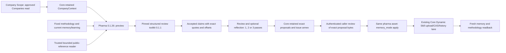

# Objective

Qualify pharma 0.1.26 as the final release candidate through one complete Company Scope → preparation/reflection → exact review → Dynamic Skill publication → readback cycle. Workflow completion alone is insufficient.

# System Context

Company Scope owns the Companies query boundary. Pharma consumes supplied CompanyContext and never queries Companies again. The toolkit resolves literal source offsets; it does not certify factual entailment or grant approval. Models own no storage authority. Fixed and Dynamic Skills reuse their existing platform capabilities; Skill writes do not require an AssetPublishPolicy. Dossier node publication remains its separate existing contract and is not requested by this cycle.

# Approach

Keep all historical versions unchanged. Install only the official promotion workflow artifact, retaining runtime version 0.1.105. Register the new exact research Agent contracts, then qualify the admitted source/tool path with `variables.preflight_only=true`, `memory_mode=preview`. This reads existing Skills and bounded public sources and invokes the pinned span tool with zero Agents and zero writes. Its output is not an eligible review packet.

Launch one fresh retained preview with `preflight_only=false`, `retain_review_packet=true`, `publish_dossier=false`, and the desired `portfolio_review_passes`. Pass 1 uses optional existing methodology; absence does not prevent preparation. Passes 2–3 reflect on admitted first-pass work. No usable admitted work means an explicit gap and skipped reflection, not a false successful pass.

All positive accepted claims require an exact literal quote from the execution's retrieved source snapshot. Model-written URLs are insufficient. The trusted reader owns HTTPS, DNS/IP/redirect safety, isolation and transport. The adapter may read the supplied website and one relevant same-origin link. Associated websites or parent-group pages do not independently establish legal-entity identity. Missing text in an excerpt does not establish a global negative.

Semantic context v2 explicitly distinguishes `relationship_kind=none` for identity/location/internal-operation facts from `bilateral` relationships. Actor or territory alone no longer invents a counterparty. True bilateral facts still require evidenced actor, counterparty and territory. Temporal, quantitative, snapshot and observation distinctions remain enforced.

# Changes Made

Version-owned helpers add bounded source retrieval, quote/span admission, the new research v3 contract, typed relationship scope, exact source snapshots in the review packet, and reviewed apply. Existing malformed-response containment and one-time faithful backup remain. A backup cannot invent or change evidence quotes.

`memory_mode=apply` consumes optional `reviewed_result` through the existing retained-output input policy, pinned to this exact asset identity and `intelligence_dossier`. The caller supplies only its producer run UUID; Assets/Core authorizes and checksum-verifies the retained content. Inline caller-created packets do not bypass that boundary.

The exact review decision contains schema `pharma_independent_review.v1`, decision `approve`, actual reviewer name and qualification basis, source run UUID, source artifact checksum, packet SHA-256, and ordered company decisions with approved fact IDs and exact memory/methodology replacement SHA-256 values. This is an authenticated caller attestation independent of the research Agents; it is not a separately authenticated expert credential or calibrated quality-release score. Never invent it from model passage, prior-run approval, a digest alone, or a placeholder reviewer.

Apply rejects incomplete/uneligible preparations, altered packets/replacements, mismatched companies, changed fixed methodology and stale memory/learning baselines. Content and whole-package digests protect both Markdown and other archive resources; snapshot IDs remain forensic references rather than cross-run authority. All requested companies' readonly baselines are checked before any mutable role. It applies the exact reviewed candidate, makes zero Agent calls, and uses existing changeset preview/apply, Core admission, upload, CAS, fresh readback and history. It never regenerates an approved proposal.

# Modularity Impact

No SQL, provider SDK, raw HTTP client, storage client, credential, lake backend selection or governance policy is added to the adapter. Public reads and callable execution use RuntimeInputs helpers. Dynamic mutation uses the existing Core Skill lane. The three researcher chain versions advance immutably; prior chains and helper bytes remain unchanged.

Memory and methodology are separate Core transactions. A partial or unconfirmed commit retains its real available receipt and safe diagnostic, reports publication incomplete, and does not retry or pretend to roll back. Other declared archive resources, including CHANGELOG.md, remain under the existing package-preserving SDK contract. Two thinking passes do not imply two Skill storage versions; Core history records actual commits.

# Validation

The deterministic suite covers single-company versus bilateral semantics, preserved temporal rules, valid siblings surviving invalid quotes, toolkit offset/digest corruption, evidence-preserving backup, two-company two-pass preparation, exact reviewed candidate application without Agent rerun, baseline drift before first mutation, and truthful partial commits. The CI stub supplies inert values/errors only; it grants no transport authority. Actual SDK and installed-artifact/runtime qualification remain separate proof boundaries.

Live closure requires fresh scope completion, actual methodology/memory reads, source/tool preflight, accepted evidence and actual reflection, retained proposals, independent caller review, real Skill apply receipts, matching post-run content/package digests and snapshot/history, and archive-resource preservation. Preserve each run/launch intent; do not blindly replay an ambiguous submission.

# Risks / Open Questions

- Existing runtime child-call budget is eight per execution. The upper bound is `company_count * (portfolio_passes + 2)`: at most two companies for one/two passes and one company for three passes. This is a work-unit limit, not a total-company limit; large jobs use existing bounded company work items/epochs. The new version rejects oversized requests before provider calls. Older versions' limits are unchanged.
- Each company has at most two public-reference reads, four source units of at most 6,000 characters each, a 60,000-byte source inventory, at most sixteen claims per role/pass and a 600-character quote. HTTP-only extraction can yield unavailable/thin sources; this must remain explicit rather than fabricated evidence.
- Agent requests retain 600 seconds / 32,000 output tokens and the 1,800-second whole-run deadline. These are finite safety bounds, not promises that every heavy case completes.
- Preview supports absent memory or methodology. Apply currently requires initialized selected packages; first packages use the existing ordinary authorized DLM ZIP upload/partition/readback capability. No empty fabricated package or new create-if-absent authority is introduced.
- No-change proposals must not be forced into fake uploads/history entries. Factual entailment, correct entity scope and candidate prose require the actual review even when exact quotes resolve.
- This candidate is not final-qualified until the real cycle closes. Do not claim all business requirements, broad calibration or ECS execution are proven by fixtures or one local-worker case.

See ENRICHMENT_V036_GUIDE.md for valid critic-disposition consolidation and the mandatory evidence-gap regressions.
