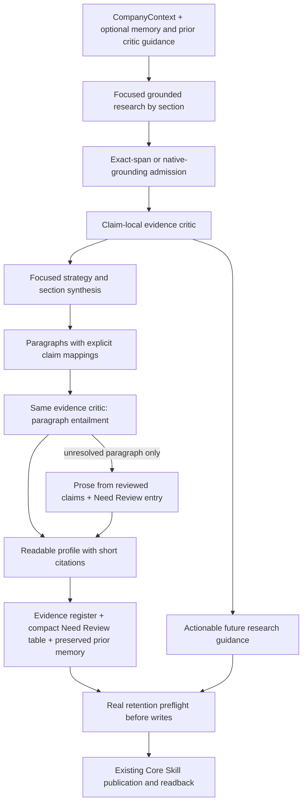

# Objective

Publish a readable company profile in the existing company-memory Skill, with
supporting evidence and compact review issues in annexes. A successful upload
alone is not evidence of profile completeness. This guide supersedes the older
release guides for 0.1.42 only; historical README/developer-guide bytes remain
immutable for additive materialization.

# System Context

The production input remains CompanyContext from Company Scope. Companies are
not queried again. Core remains the sole Skill ZIP, partition, CAS, upload,
readback and history authority. Filenames, lake/node configuration, provider
models and timeouts are unchanged. Benchmark remains disabled. No caller review
packet or human publication approval is introduced.

# Approach

Every original and sole backup is measured. The same projected payload is sent,
including guidance, iteration and semantic rules. Downstream packets contain
only their claims, relevant sources and up to 2,400 characters of whole prior
paragraphs. Omitted context is explicitly partial. No paragraph is clipped to
pretend it fits. Irreducible oversized pieces remain gaps.

One pass remains the default. Passes two and three read the preceding in-memory
profile and critic guidance, under the same global budget, then publish once.
There are at most 48 provider dispatches, concurrency 1–3 (default 2), 3,300
seconds of preparation and the existing publication reserve. Each Agent keeps
its 1,200-second ceiling; workflow execution stays 3,600 seconds. The critic has
room for 16 calls per company before optional reflection scaling, still bounded
by the global cap. Paragraph checks do not create another workflow or retry lane.

# Changes Made

The previous publication renderer discarded synthesis prose and emitted a fact
ledger. Version 0.1.42 reads actual section/subsection prose, requires explicit
`[[claim_id]]` support per paragraph, and uses the existing evidence critic to
check entailment, dates, uncertainty, quantities, identity and inference labels.
Markers alone never establish truth. Unsupported/malformed presentation is
replaced only for the affected piece with prose assembled from already reviewed
statements. Those fallbacks are labelled in the dossier. Unknown evidence is not
filled with model knowledge.

The main document contains paragraphs and short `[R1]` citations. Evidence dates,
source basis and each full locator appear in one Evidence annex. A Need Review
table contains section/subsection, paragraph number when known, issue and short
reference. Prior memory is preserved verbatim in a Previous Memory annex; Core
also retains its normal history. Source text, hidden markers and provenance are
not repeated in every downstream prompt. Storage naming is unchanged.

The document H1 uses the supplied company name (for example, `# Pfizer`). The
company ID remains the partition selector. First packages use this title, and
eligible updates rename the existing title in the same changeset as the section
content. The companion generic SDK `rename_title` operation preserves section
paths, frontmatter, digest checks and history; it requires the officially built
Assets artifact before this adapter is admitted. It adds no Core route or write
authority. Existing documents are not silently migrated by a no-change run.

The four research sections receive explicit supported-content/evidence-gap
status. Coverage counts now count sections with actual content, not empty
canonical containers. `profile_coverage_complete` cannot become true merely
because all Agent invocations completed. It remains an automated bounded-pass
assessment, not an independently adjudicated comprehensive company profile.

Future methodology stores critic observations, next actions and success checks.
Repeated scoped actions with the same normalized next action and success check
are not appended again. Similar-sounding but different actions are not silently
merged or declared resolved. Claim deduplication is conservative: normalized
statement plus date, qualifiers and inference state, not fuzzy semantic deletion.

Retention uses the runtime's real validator before any Skill mutation. An unsafe
candidate withholds that company's publication with a content-free diagnostic.
An unsafe optional result field is omitted explicitly, with field name, size,
digest and safe rejection detail, while an independently safe exact profile can
still publish. Rejected content is neither rewritten to bypass checks nor moved
into an exempt output shape. Storage/credential/authority failures remain strict.

# Modularity Impact

Business repair lives in adapter-intake and uses additive version-owned helpers.
Generic Markdown retention, predicate diagnostics and Skill title changes belong
in Assets. Deliver
both through the official promotion/artifact workflow; do not hand-replace wheels
or change the runtime version merely to deliver this adapter. No Core change is
needed. Previous adapter/helper and shared documentation bytes remain unchanged.

# Validation

Required provider-free acceptance cases:

| Requirement | Acceptance evidence |
|---|---|
| Narrative reaches storage | Exact synthesized, critic-supported paragraph is found in the fake Skill readback, not just the dossier. |
| Company-name title | Fresh and existing Skills use the supplied name through the real SDK; the partition remains the company ID. |
| No invented narrative | Missing/cross-section IDs or negative paragraph decisions use local fallback and an annex entry. |
| Useful partial execution | Supported sibling claims publish; missing evidence stays a gap. |
| Historical fidelity | Historical dates and qualifications survive fallback prose. |
| Compact evidence | Short inline refs; one full current reference per Evidence register. |
| Input parity | Actual dispatch is focused, measured and inside shared call/concurrency limits. |
| Reflection | Second pass consumes prior profile/guidance; no intermediate publication. |
| No unnecessary writes | Preview writes nothing; identical rerun leaves memory unchanged. |
| Retention parity | Real SDK validates the native-grounding dossier; rejected candidates never mutate. |
| Compatibility | Full deterministic suite, intake shape, immutable earlier bytes and packaged imports pass. |

Run `python -B -m unittest discover -s adapters/nusaibah/pharma_company_intelligence_lab/tests -p test_readable_profile_v0_1_42.py -v`
against the real runtime as well as the normal intake stub suite. Stub-based CI
is not evidence of runtime retention security or live provider output quality.

# Risks / Open Questions

- Automated paragraph criticism can miss factual errors. It does not replace
  adjudicated business evaluation; claims retain their evidence and qualifications.
- Real search may return inadequate evidence. The adapter must retain explicit
  gaps, not promise every company always has a complete profile.
- A large preserved baseline can exhaust the existing 24,000-character Skill
  candidate limit. Whole omitted paragraphs are reported; prior content is not
  silently deleted or truncated. A future archive/compaction design needs a
  separate preservation contract; this release does not add one.
- Claim and paragraph critics share the same budget. Exhaustion uses reviewed
  claim prose and records the local issue; it never manufactures a critic pass.
- Current-run retention preflight is not a promise that Core storage/readback
  will be available. Cross-Skill publication remains two real Core transactions.
- No new paid run, merge, promotion, registration or installation is part of this
  repair verification. A new live full-profile proof remains a separate step.
