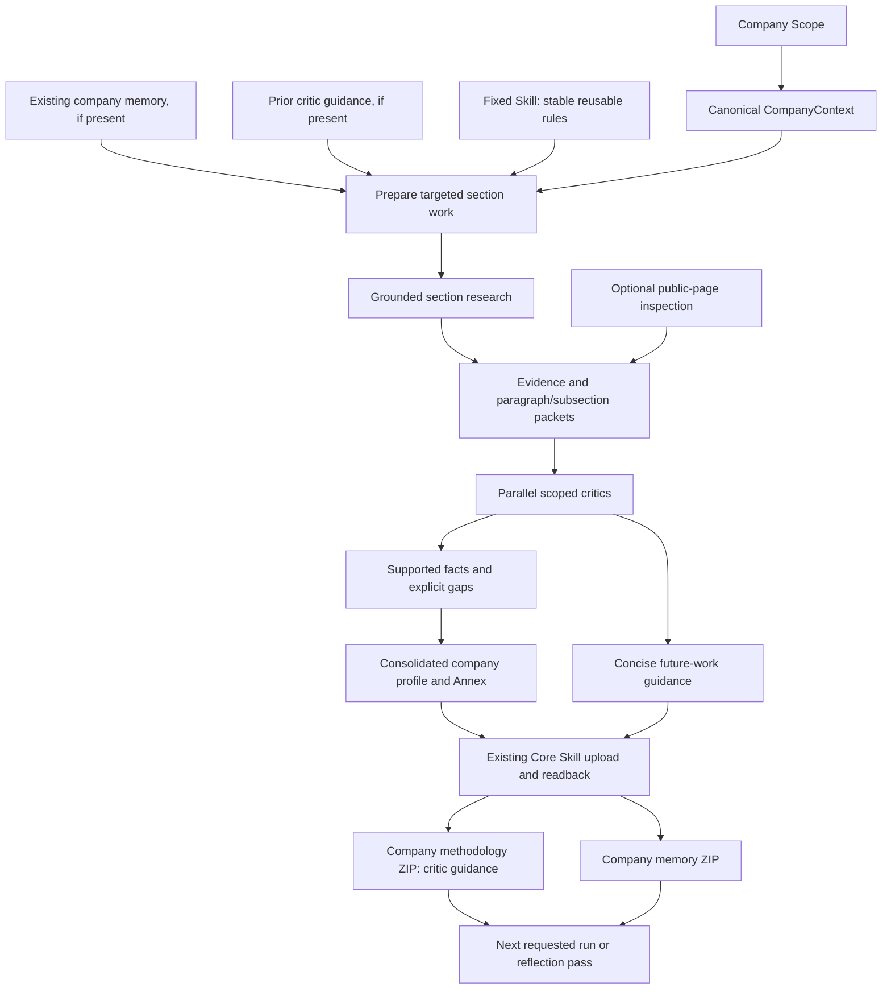

> Version 0.1.40 implementation candidate. Implementation is authorized; merge, promotion and paid live qualification are not part of this change. This retained requirements baseline describes the target. See [current implementation and limitations](ENRICHMENT_V040_GUIDE.md) and [verification evidence](VERIFICATION_V040.md) before treating any criterion as satisfied.

# Company intelligence — requirements and prioritized improvements

Date: 14 October 2026, Asia/Amman. Status: **implementation authorized; merge and live qualification pending**.

Companion: [Acceptance criteria and verification plan](ACCEPTANCE_V040.md).

## Objective

Produce useful, evidence-grounded company intelligence through one integrated production flow. Grounded research gathers new information. Scoped critics improve factual quality and advise how the next Agent pass should improve. Published memory contains the resulting company profile, supported enrichment and a compact review annex. Company methodology contains actionable future-work guidance from the critic, rather than a repeated explanation of methodology.

Priority order:

1. Useful, precise company intelligence supported by actual research.
2. Truthful provenance, correct company identity and explicit uncertainty.
3. Paragraph/subsection work, local defect containment and preserved supported results.
4. Critic feedback that measurably guides future work.
5. Efficient execution and verified publication through existing platform capabilities.

Do not optimize for a larger ZIP, more Agent calls, a minimum word count, or an all-green review. Content usefulness and factual support are the objectives.

## System Context

The current company-59 run completed and its memory ZIP was uploaded and read back, but the business objective remains incomplete. Read-only investigation established:

| Observation | Evidence |
| --- | --- |
| Production run | `ab2ff4ca-e9da-4cc5-93eb-a65d5132eca0`, pharma 0.1.39 |
| Website acquisition | One failed read, `public_reference_http_failed`; exact HTTP status not retained |
| Admitted source inventory | One `company_context:59` unit, 244 characters |
| Provider search | Not requested by any of the 14 completed Agent calls |
| Memory content | 931 UTF-8 bytes; one historical 2019 address/website finding |
| Published ZIP | 1,075 bytes, upload 164, fresh readback verified |
| Quality | Company Profile validated; three specialist sections lack sufficient evidence |
| Review annex | Present in retained JSON; missing from published Markdown |
| Methodology | No proposal created; `no_change`, partition absent |
| Methodology guard | Current preparation builds learning only when the aggregate critic recommendation is `pass` |

Evidence: [live investigation](../company59-retention-resume-20261014/Live-Publication-Report.md), [research diagnostics](../company59-retention-resume-20261014/research-gap-proof.json), [published-content measurements](../company59-retention-resume-20261014/published-content-proof.json), [Agent receipts](../company59-retention-resume-20261014/agent-receipt-proof.json).

These findings prove a design gap: successful storage and isolated evidence checking have displaced the intended grounded-research objective. Disabling benchmark does not mean disabling grounded search.

## Approach

### Intended model

Grounded research owns discovery. Public-reference reads are an additional inspection capability, not a universal prerequisite for provider search or acceptance of valid native grounding. Critics assess claim support and improve the profile; they are not human approval authorities. Missing evidence does not mean the rest of the company's work is invalid.

A critic's section-level `needs_enrichment` or negative overall recommendation must not discard supported claims within that same section. A section can contain useful supported facts and unresolved questions together. Withhold or qualify the actual defective claims, retain the supported material, and make the remaining work visible in the Annex and future guidance.

Use one execution/publication lane. Company Scope remains the Companies query owner; downstream intelligence consumes CompanyContext. Core remains the persistence/history authority. This diagram proposes behavior; it does not assert that the repair is deployed.

## Changes Made

**Version 0.1.40 implementation candidate.** See ENRICHMENT_V040_GUIDE.md for implemented changes and VERIFICATION_V040.md for evidence. Historical helpers, current deployed assets and runtime configuration remain untouched.

### Required improvements

P0 means required before calling the repaired company-intelligence cycle complete. P1 means required for the associated optional reflection/optimization behavior; it must not silently become another mandatory stage.

| ID | Priority | Requirement | Required behavior |
| --- | --- | --- | --- |
| R01 | P0 | Restore actual grounded discovery | Researcher Agent contracts request native grounded search for their assigned sections, using CompanyContext to identify the target. This occurs even if the company website is missing, unreadable or blocked. |
| R02 | P0 | Separate grounding from page extraction | Runtime-admitted native search evidence can proceed to semantic critique without a mandatory full-page HTTP reread. Literal source-text verification remains available for admitted readable sources. A model-written URL alone is never evidence. |
| R03 | P0 | Research relevant sources | Section work searches for sources appropriate to the question: official company disclosures, product evidence, regulatory records and other relevant evidence. Do not restrict discovery to one homepage and one same-origin link. Preserve company/entity/date distinctions. |
| R04 | P0 | Preserve targeting and chunking | Route work by section/subsection; chunk long retrieved documents by paragraph or subsection before forwarding them. Do not make every Agent review the entire growing profile or repeat identical evidence. |
| R05 | P0 | Make critics constructive | The existing scoped critic returns claim-quality decisions and actionable next-work guidance in the same response. It assesses evidence, freshness, entity identity, duplicates and contradictions. Supported claims survive even within a section that needs more enrichment; its overall verdict is not a publication approval. |
| R06 | P0 | Redefine company methodology as feedback memory | Persist selected critic guidance for future research, such as evidence gaps, better query/source choices, mistaken assumptions and verification improvements. Do not regenerate a methodology essay, copy the fixed Skill or append generic hardcoded lessons on every run. |
| R07 | P0 | Learn from partial outcomes | A failed/insufficient section may yield useful procedural guidance. Persist that guidance when valid, without requiring every section to pass. This grants no permission to publish the section's unsupported factual claims. |
| R08 | P0 | Read previous work and guidance | A new run reads existing memory and relevant critic guidance, if present. First-run absence is supported. Prior guidance demonstrably affects the relevant researcher/critic input. Never assume a package exists merely because a previous run completed. |
| R09 | P0 | Publish usable company content | Publish a coherent supported company profile and enrichment, with concise citations and qualifications. Preserve previous content. Do not present a copied historical identity record as fresh intelligence or replace useful prose with generic diagnostic placeholders. |
| R10 | P0 | Persist the quality annex | Every published memory/report with outstanding issues includes `Annex: Need Review` as a compact table. Use section/subsection and paragraph when known, a short issue and a simple reference. Do not copy full source text or invent paragraph numbers. |
| R11 | P0 | Contain defects locally | Missing evidence, non-applicability, unparseable business responses, retrieval problems and exhausted optional recovery affect only dependent work. Supported siblings continue. Authentication, governance, wrong destination, integrity, identity/scope conflict and confirmed write failures retain their legitimate platform boundaries. |
| R12 | P0 | Preserve parsing and one backup | Every Agent role uses deterministic JSON/wrapper handling and the existing single backup where applicable. The backup repairs response representation and cannot invent grounding, claims or a positive critic verdict. Persistent failure becomes a scoped annex/diagnostic entry. |
| R13 | P0 | Report outcomes truthfully | Report execution, publication and business quality separately using existing result fields. Show search actually requested, useful enrichment versus baseline reuse, outstanding issues and actual memory/methodology receipts. Avoid creating another hierarchy of workflow statuses. |
| R14 | P0 | Reuse the existing Skill lane | Publish memory and valid critic guidance through current Dynamic Skill initialization/update, partition, ZIP, freshness/CAS, history and readback capabilities. No duplicate storage authority, per-Skill policy lane or manual storage writes. Preserve other ZIP resources and changelog behavior. |
| R15 | P0 | Preserve existing assets and delivery | Implement in adapter-intake only after scope is settled. Keep historical adapter/Agent versions immutable; use normal promotion, admission and official artifact delivery. No direct edits to promoted business copies, manual wheel replacement or runtime version bump for this plan. |
| R16 | P1 | Reduce redundant paid work | Use deterministic section routing where stable rules suffice. Forward concise task-specific fixed rules and relevant prior guidance, rather than whole documents. Deduplicate repeated facts, sources and guidance. Do not create another LLM call just to describe methodology. |
| R17 | P1 | Support requested reflection without forced repetition | The default E production runner performs one targeted pass. If two or three passes are requested in a qualified contract, later passes use earlier supported findings and critic guidance. Work in RAM between passes and publish the consolidated result once. Do not assume the current one-pass-only 0.1.39 already supports this. |
| R18 | P0 | Bound execution without suppressing research | Preserve configured time/token/input bounds, measured packets and bounded parallelism. Allocate discovery, critique and synthesis within the same company work budget. Exhaustion yields scoped incomplete work, not unlimited retries or fabricated completion. Finite bounds are operational safeguards, not an excuse to disable search. |
| R19 | P0 | Preserve useful diagnostics | Keep safe error code, phase and HTTP status when supplied by existing capabilities. Keep role, section and paragraph/chunk references. Never expose credentials, raw exception bodies or full sensitive documents in operational summaries. |
| R20 | P0 | Establish one current documentation entry | Publish this model and acceptance matrix as the current developer direction. Clearly mark historical manual-review and source-only release descriptions by version; do not let them read as current production requirements. Link the README to the current contract. |

### Evidence contract

Native grounding and literal-source inspection provide different evidence. Preserve their distinction in data and presentation:

| Evidence basis | Meaning | Admission rule |
| --- | --- | --- |
| Governed CompanyContext | Internal company baseline, possibly historical | Preserve source/snapshot/date; not proof of fresh public discovery |
| Runtime-admitted native grounding | Provider-grounded research linked to admitted citations/support where available | Match claims to actual runtime evidence and scope; critic checks support; no fabricated direct-source quote/offset |
| Retrieved source text | A readable source admitted through platform capabilities | Preserve literal quotes, source snapshot and exact offsets for applicable verification |
| Previous memory | Historical retained intelligence | Reuse as history, avoid circular sourcing and duplicate novelty claims |
| Model inference | Reasoning from admitted evidence | Label as inference, retain supporting facts and uncertainty; do not present it as independently verified fact |

An unavailable page inspection becomes an explicit uncertainty/annex item when relevant. It does not delete valid native-grounded research solely because direct HTTP extraction failed. Native citations are still not an automatic guarantee of truth; the critic must evaluate the supported claim and qualifications.

### Company methodology contract

Keep the existing `company_methodology` Skill identity and persistence lane. Its learned content answers: **what should the next Agent do differently for this company's work?** Fixed Skill remains the reusable platform/review instructions.

A feedback item should carry concise typed values for:

| Field | Purpose |
| --- | --- |
| Target section/subsection and Agent role | Route guidance only to relevant work |
| Observed issue and basis | Explain the actual defect/gap rather than recite theory |
| Recommended next action | Give a specific search, verification or reasoning improvement |
| Expected verification | State what observable evidence would resolve/improve the issue |
| Priority and applicability | Avoid spending on irrelevant advice |
| Origin run and available reference | Preserve provenance without full source copying |
| Resolution/supersession relation | Prevent endless repetition of already resolved guidance |

Exact field names, schema version and bounds are implementation design choices to settle against existing contracts; this table is not a currently deployed JSON schema.

Illustrative feedback: **Company Profile / portfolio researcher:** the accepted address is from a historical snapshot; retrieve a current official contact/disclosure source, preserve the 2019 fact as historical, and only add a current headquarters claim if current evidence supports it. Resolution requires a traceable current source and an explicit date basis. This is critic guidance, not an unverified assertion that the address has changed.

No separate methodology-description Agent is required. Extract valid feedback from the critic response, deduplicate it deterministically, preserve prior useful guidance and write only an actual delta. `no_change` needs an explicit reason. Learning from an insufficient section must not manufacture a passing quality decision.

### Published memory contract

The document should contain the supported profile/enrichment, historical/current distinction, relevant bounded reasoning and the review annex. Its business value must be inspected, not inferred from byte size. The retained runtime JSON remains an evidence/diagnostic artifact, not a substitute for the published document.

| Section / subsection | Paragraph | Issue | Ref. |
| --- | --- | --- | --- |
| Example: product portfolio / key products | Known paragraph number or — | Short unresolved issue | `[n]` or — |

Use a small reference list for existing cited sources. Unknown paragraph/reference remains `—`. A guidance-only or no-finding outcome must remain explicit; never create fake facts or claim an absent package was uploaded.

## Modularity Impact

Company Scope selects/resolves companies. Intelligence gathers evidence and produces supported analysis. Critics produce scoped quality decisions and next-work guidance. The adapter coordinates those roles. Assets/Core own capability admission, governance, storage, integrity and history. Lake backend resolution stays outside business workflow logic. Existing bounded company work-item/epoch execution remains the scale boundary; this plan does not introduce batch infrastructure.

## Validation

The companion matrix defines provider-free regressions, exact promoted-package/admission checks and a later explicitly authorized live content check. See VERIFICATION_V040.md for offline evidence and outstanding live stages. Historical upload/readback evidence proves only the historical boundaries it actually exercised.

These are release-verification requirements, not extra per-company approval gates or mandatory Agent calls. Research, critique and publication remain one ordinary production flow; the matrix is used to prove that implementation behaves as intended.

## Risks / Open Questions

| Risk/question | Direction to settle |
| --- | --- |
| Native grounding metadata available through the current SDK | Verify actual runtime citation/support shapes before choosing claim-level projection. Do not assume a provider response contains literal webpage text. |
| Search result URLs and redirect/reference admission | Use existing admitted reference capabilities; do not bypass DNS, private-network, credential or governance restrictions. |
| Critics becoming universal publication approval | Validate selected evidence locally; keep unrelated incomplete sections and actionable feedback. No human-review gate or enabled benchmark is implied. |
| Empty boilerplate feedback | Require an observed company/section issue and actionable next step; avoid generic static lessons. |
| All sections forced onto every company | Scope applicability honestly. Missing evidence is not proof of non-applicability. |
| More research increasing paid cost | Measure per-role calls/usage and relevance; bounded targeted search, deduplication and selected guidance reduce duplication. No arbitrary minimum fact/word count. |
| Guidance repeating forever | Match resolved/superseded issues and stop re-forwarding them; retain their history through the existing Skill lane. |
| Two/three passes exceeding execution budget | Qualify the optional contract and remaining budget before claiming support. Default one-pass behavior remains. |
| Whole profile versus enrichment delta | Preserve existing memory and publish a readable consolidated profile in the current Skill document; avoid a new independent dossier-storage lane. |
| Documentation of obsolete restrictions | Version-label historical release requirements and establish one current entry point before release. |

Implementation was subsequently authorized. Merge, Agent provisioning, promotion installation and another paid run remain stopped for review.
